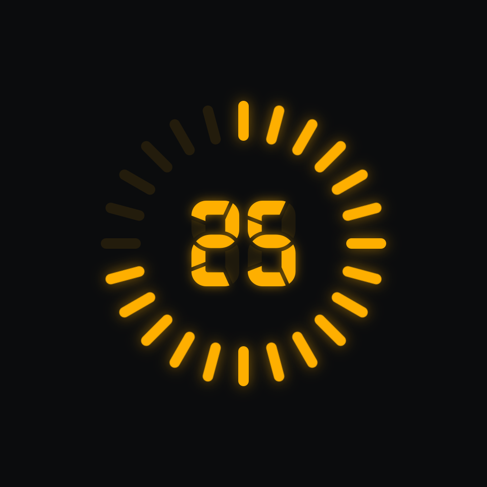
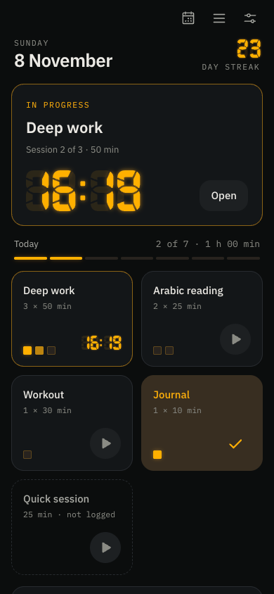
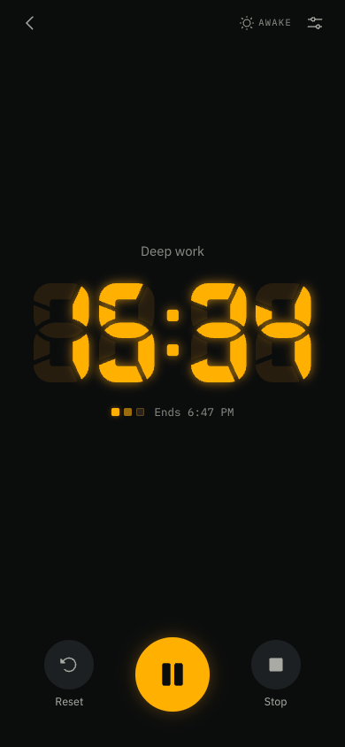
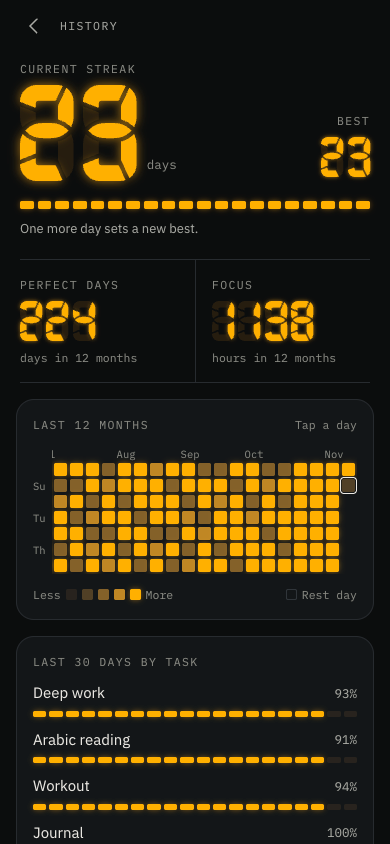

<p align="center">
  
</p>

<h1 align="center">Detonato</h1>

<p align="center">A pomodoro app for the day you planned.</p>

List what you do every day, or on chosen weekdays, and how many sessions each
task takes. Every session counts down on a segment display, and a
GitHub-style graph shows how much of each day got done.

<p align="center">
  
  
  
</p>

## Download

Detonato isn't on the App Store or Google Play. Get it from
[detonato.wintercore.xyz](https://detonato.wintercore.xyz):

- **In your browser:** [detonato-app.wintercore.xyz](https://detonato-app.wintercore.xyz),
  nothing to install.
- **Android:** [detonato.apk](https://detonato.wintercore.xyz/downloads/detonato.apk).
  Let your browser install it when it asks.
- **iPhone:** [detonato.ipa](https://detonato.wintercore.xyz/downloads/detonato.ipa),
  unsigned: install it with [AltStore](https://altstore.io),
  [SideStore](https://sidestore.io) or [Sideloadly](https://sideloadly.io).

## Features

- **Tasks in sessions.** Each task has its weekdays, 1 to 8 sessions, and its
  own length or the default, from 1 to 95 minutes.
- **A real segment display.** 88 designs from Posy's Segmented Display
  Designs Sheet, in five LED colours, every segment lit on its own.
- **Today.** The session under way or the one up next, the day's progress, a
  tile per task, and quick sessions that aren't logged.
- **History.** The current and best streak, perfect days and focus over the
  last 12 months, a year of days to tap through, and each task's last 30 days.
- **A notification when a session ends,** with sound and vibration, even with
  the app closed (iOS and Android).
- **Edits never rewrite the past.** Each day is judged by the plan it had then,
  so changing or deleting a task leaves your streak alone.
- **Yours, on your phone.** No account and no server: everything stays on the
  device, and a backup is one file you keep.

## Repository

| Folder | What's in it |
| --- | --- |
| `app/` | The app: React 19, TypeScript, Tailwind v4, Zustand and Vite, with iOS and Android shells through Capacitor 8 |
| `landing/` | The landing page: Astro and Tailwind v4 |
| `mockup/` | The first design mockup, a single HTML page |
| `segment-designs.svg` | Posy's sheet, the source of every display design |

[AGENTS.md](./AGENTS.md) is the contributor guide: the folder layout, the
code rules, how state and the timer work, and how to build the native apps.

## Getting started

You need Node 22.12 or newer and pnpm.

```sh
pnpm install
pnpm dev        # the app, at http://localhost:5190
pnpm landing    # the landing page, at http://localhost:5191
pnpm test       # unit tests
pnpm e2e        # end-to-end tests (Playwright on the system Chrome)
pnpm lint
pnpm build      # both packages
pnpm downloads  # the APK and IPA, into landing/public/downloads (needs the release key, Android Studio and Xcode)
```

For the phone apps: `cd app && pnpm build && pnpm exec cap sync`, then open
`app/android` in Android Studio or `app/ios/App/App.xcodeproj` in Xcode.

## Credits

- Segment designs by [Posy (Michiel de Boer)](https://michieldb.nl), from his
  Segmented Display Designs Sheet v1.1, free for non-commercial use.
- Fonts: [IBM Plex](https://github.com/IBM/plex) Sans and Mono.
- Icons: [Phosphor](https://phosphoricons.com).

## License

Detonato is a non-commercial, open-source project. Its code is under the
[MIT License](./LICENSE). The segment designs (`segment-designs.svg`, and
`app/src/core/segments/glyphs.json` made from it) are Posy's and are not
covered by it: they're free for non-commercial use only.
